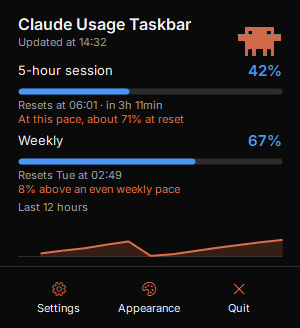
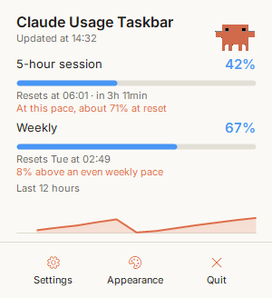
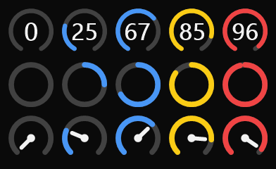
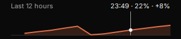
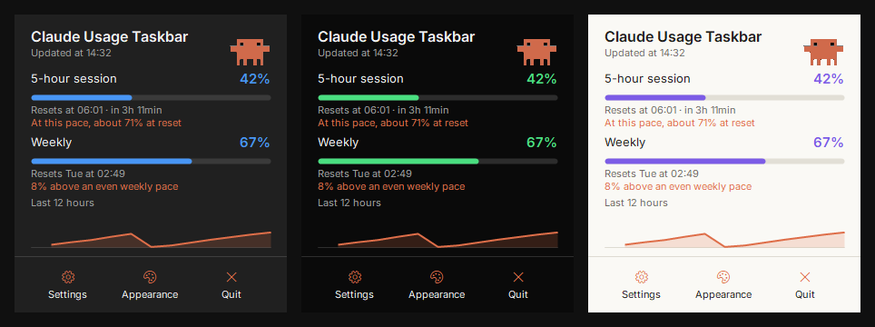
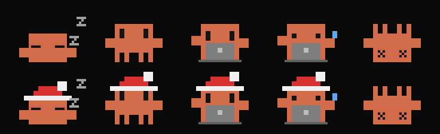
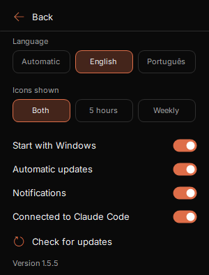
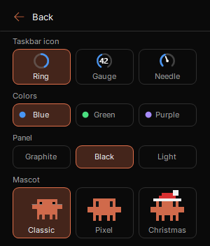

# Claude Usage Taskbar

[English](README.md) | [Português (Brasil)](README.pt-BR.md) | **Español** | [Русский](README.ru.md)

Consulta los límites de uso de Claude Code en la barra de tareas de Windows, sin abrir nada.

> La aplicación está disponible en inglés y portugués. Las capturas de esta página están en inglés.

<p>



</p>

> Proyecto comunitario no oficial. No tiene relación con Anthropic, ni cuenta con su aprobación o soporte. "Claude" es una marca de Anthropic.

## Funciones

- Iconos en la barra de tareas con tu uso de **5 horas** y **semanal**. Muestra ambos o solo uno
- Tres estilos de icono: **Ring**, **Gauge** y **Needle**
- Tres plantillas de color y tres temas de panel
- Un panel con horas de reinicio, previsión de ritmo y un gráfico de 12 horas
- Una mascota animada, con versiones pixeladas que reaccionan a tu uso
- Alertas opcionales al 80% y al 90% de un límite
- Se inicia con Windows, con accesos directos en el Escritorio y el menú Inicio
- Actualizaciones automáticas firmadas
- **Nunca lee tu inicio de sesión ni tu token de Claude**

## Instalación

### Antes de empezar

Necesitas:

- Windows 10 u 11
- [Claude Code](https://code.claude.com/docs) instalado y con sesión iniciada en un plan Pro, Max o Ultra. Para iniciar sesión, ejecuta `claude` una vez en una terminal

No hace falta dejar una terminal abierta.

### Paso a paso

1. **Descarga** `ClaudeUsageTaskbar.exe` desde la [última versión](https://github.com/ggleoo/claude-usage-taskbar/releases/latest).
2. **Abre el archivo descargado.** Windows puede mostrar un aviso de SmartScreen, porque la aplicación no tiene un certificado de firma de código de pago. Elige **Más información** y luego **Ejecutar de todas formas**. Si lo prefieres, antes [comprueba el archivo](SECURITY.md#verify-a-download) o [compílala tú mismo](#compilar-desde-el-código).
3. **Elige Yes** en la ventana de instalación. La aplicación se instala solo para tu usuario de Windows y se conecta a Claude Code por ti. Después puedes borrar el archivo descargado.
4. **Mantén visibles los iconos.** Windows oculta los iconos nuevos de la bandeja. Arrástralos desde el menú **^** a la barra de tareas, o ve a **Configuración > Personalización > Barra de tareas > Otros iconos de la bandeja del sistema** y actívalos. Son dos iconos, uno para cada límite.
5. **Espera unos segundos.** Los porcentajes aparecen en los iconos, lo que significa que funciona.

## Uso

1. **Lee los iconos.** El límite de 5 horas tiene el número blanco y el semanal tiene el número de color. El color cambia al 70% y pasa a rojo al 90%.
2. **Pasa el ratón** sobre un icono para ver el porcentaje y la hora de reinicio.
3. **Haz clic** en un icono para abrir el panel. Haz clic fuera o pulsa **Esc** para cerrarlo.
4. **Elige un estilo de icono** en **Appearance**.
5. **Abre Settings** en el panel para todo lo demás, y **Appearance** para los colores y la mascota.

**Quit** solo cierra esta aplicación. No cierra tu sesión de Claude. Vuelve a abrirla desde el menú Inicio o el Escritorio.

## Qué puedes ver y cambiar

### Estilos de icono



Elige uno en **Appearance**. De arriba abajo:

- **Gauge:** un indicador con el número dentro.
- **Ring:** un círculo que se llena en sentido horario desde arriba. Es el estilo predeterminado.
- **Needle:** un indicador con aguja.

### Gráfico de uso



El gráfico muestra tu uso de 5 horas durante las últimas 12 horas. Pasa el ratón por encima para ver la hora, el porcentaje en ese momento y cuánto subió desde la lectura anterior.

### Previsión de ritmo

- **Límite de 5 horas:** la previsión combina tu media de toda la ventana con la tendencia reciente, para que un pico aislado no la domine. Aparece a partir del 5% de uso y 15 minutos de datos.
- **Límite semanal:** compara tu uso con un ritmo uniforme a lo largo de la semana. Muestra una diferencia, no una predicción.

### Colores y temas



En **Appearance**:

- **Colors:** azul de forma predeterminada, o verde o morado. Se aplican a los iconos y las barras.
- **Panel:** grafito, negro o claro.

### Mascota

De forma predeterminada, el panel muestra la mascota **Classic** trabajando en su portátil:


Elige **Pixel** o **Christmas** y reaccionará a tu uso. De izquierda a derecha:



| Estado | Cuándo |
|---|---|
| Durmiendo | Sin uso durante más de 45 minutos, o aún sin datos |
| Descansando | Tu último uso fue hace entre 10 y 45 minutos |
| Trabajando en su portátil | El porcentaje de la sesión subió en los últimos 10 minutos |
| Cansada y sudando | Está trabajando y un límite está al 90% o más |
| Caída | Un límite llegó al 100% |

En **Appearance** puedes elegir el aspecto:

- **Classic:** la animación original, que no reacciona al uso. Es la predeterminada.
- **Pixel:** la mascota que reacciona al uso, en la fila superior.
- **Christmas:** la misma mascota con gorro de Papá Noel, en la fila inferior.

Este es un proyecto de fans, sin relación con Anthropic ni aprobación suya, y el personaje pertenece a sus dueños. La licencia MIT no lo cubre.

### Configuración

<table>
<tr>
<td></td>
<td></td>
</tr>
</table>

| Opción | Qué hace |
|---|---|
| Language | Automático, inglés o portugués |
| Icons shown | Ambos límites, solo 5 horas o solo semanal |
| Start with Windows | Abre la aplicación al iniciar sesión en Windows |
| Automatic updates | Instala por sí sola las actualizaciones firmadas |
| Notifications | Alertas al 80% y al 90% de un límite, y un aviso cuando se instala una actualización |
| Connected to Claude Code | Activa o desactiva la conexión |
| Check for updates | Busca una actualización ahora. El icono gira mientras comprueba y se convierte en un icono de descarga cuando hay una lista |

## Cómo funciona la conexión

La aplicación lee tus límites de dos formas oficiales:

- **Comando `/usage`:** cada 2 minutos ejecuta `claude -p /usage` en segundo plano, con los mismos números que ves en Claude Code. No llama al modelo ni gasta tokens.
- **[Status line](https://code.claude.com/docs/en/statusline):** durante la instalación, añade una entrada `statusLine` a `~/.claude/settings.json` y guarda una copia de seguridad al lado. Claude Code envía entonces números nuevos con cada respuesta en una terminal.

En ambos casos, la aplicación guarda solo los porcentajes y las horas de reinicio de los límites de 5 horas y semanal en `%LOCALAPPDATA%\ClaudeUsageTaskbar`, y descarta el resto. El widget lee ese archivo.

Conviene saber:

- **Cuenta el uso desde cualquier lugar.** claude.ai, la aplicación de escritorio y las terminales aparecen en un máximo de 2 minutos.
- **Si ya tienes una status line, se conserva.** Sigue ejecutándose y mostrando lo mismo que antes. Al desinstalar, se restaura.
- **Para desconectar,** desactiva **Connected to Claude Code** en Settings.

## Seguridad y privacidad

- No lee tu inicio de sesión, tu token ni tu archivo de credenciales.
- No guarda tus prompts, datos de sesión ni rutas de proyectos.
- No tiene analíticas, telemetría ni cuentas.
- El acceso a la red de la propia aplicación es solo comprobar en GitHub si hay actualizaciones firmadas, y puedes desactivarlo. El comando `/usage` es de Claude Code, que usa tu inicio de sesión sin mostrárselo a la aplicación.

Los detalles están en [SECURITY.md](SECURITY.md), en inglés.

## Actualizaciones

Al abrirse y después cada hora, la aplicación comprueba la última versión en GitHub. Solo instala una actualización si su firma digital coincide con la clave integrada en la aplicación, así que un archivo manipulado se rechaza. Puedes desactivarlo en Settings, donde **Check for updates** también hace una comprobación al momento. La comprobación al abrirse instala la actualización de inmediato, sin preguntar. Las comprobaciones siguientes esperan a que se cierre el panel y, mientras tanto, muestran un enlace para instalarla. Una notificación confirma la actualización, salvo que desactives **Notifications**.

## Desinstalación

Ve a **Configuración de Windows > Aplicaciones > Aplicaciones instaladas > Claude Usage Taskbar > Desinstalar**. Esto elimina la aplicación, los accesos directos y los ajustes, y restaura tu status line de Claude Code.

## Solución de problemas

| Problema | Qué hacer |
|---|---|
| "Waiting for Claude Code" | Espera unos segundos. Si continúa, ejecuta `claude` en una terminal para comprobar que Claude Code está instalado y con la sesión iniciada. |
| Siguen sin aparecer los porcentajes | Comprueba que **Connected to Claude Code** esté activado y ejecuta `claude -p /usage` en una terminal. Los datos están disponibles en los planes Pro, Max y Ultra. |
| Los iconos están ocultos | Sigue el paso 4 del [paso a paso](#paso-a-paso). |
| No se pudo activar la conexión | `~/.claude/settings.json` puede tener un JSON no válido. Corrígelo e inténtalo de nuevo. |
| Un porcentaje parece antiguo | Es el último valor que se pudo leer. La aplicación lo intenta de nuevo cada 2 minutos. |

## Compilar desde el código

No hace falta ningún SDK, porque Windows incluye el compilador de C#.

```powershell
git clone https://github.com/ggleoo/claude-usage-taskbar.git
cd claude-usage-taskbar
pwsh -File scripts/build.ps1
```

La aplicación se genera en `bin\ClaudeUsageTaskbar.exe`. Usa `--portable` para ejecutarla sin instalar.

Si quieres contribuir, lee [CONTRIBUTING.md](CONTRIBUTING.md).

## Créditos

El panel usa [Inter](https://github.com/rsms/inter), con licencia SIL Open Font License. Consulta [assets/fonts/NOTICE.md](assets/fonts/NOTICE.md).

## Licencia

[MIT](LICENSE)
