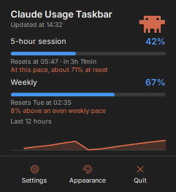
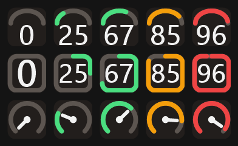
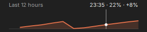
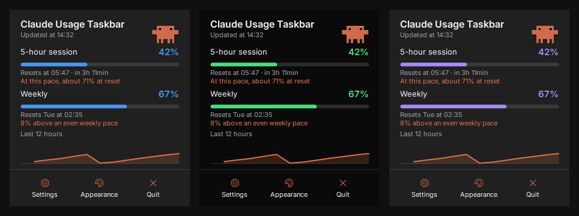
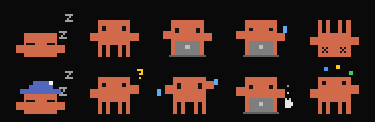
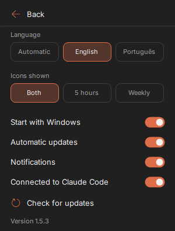
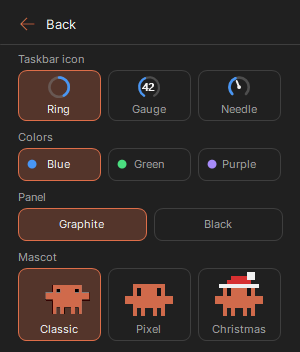

# Claude Usage Taskbar

**English** | [Português (Brasil)](README.pt-BR.md) | [Español](README.es.md) | [Русский](README.ru.md)

See your Claude Code usage limits in the Windows taskbar, without opening anything.



> Unofficial community project. It is not affiliated with, endorsed by, or supported by Anthropic. "Claude" is a trademark of Anthropic.

## Features

- Taskbar icons with your **5-hour** and **weekly** usage. Show both, or only one
- Three icon styles: **Ring**, **Gauge** and **Needle**
- Three color templates and two panel themes
- A panel with reset times, a pace forecast and a 12-hour chart
- An animated mascot, with pixel versions that react to your usage
- Optional alerts at 80% and 90% of a limit
- English and Brazilian Portuguese, following your Windows language by default
- Starts with Windows, with Desktop and Start menu shortcuts
- Signed automatic updates
- **Never reads your Claude login or token**

## Install

### Before you start

You need:

- Windows 10 or 11
- [Claude Code](https://code.claude.com/docs) installed and signed in with a Pro, Max or Ultra plan. To sign in, run `claude` in a terminal once

You do not need to keep a terminal open.

### Step by step

1. **Download** `ClaudeUsageTaskbar.exe` from the [latest release](https://github.com/ggleoo/claude-usage-taskbar/releases/latest).
2. **Open the downloaded file.** Windows may show a SmartScreen warning because the app has no paid code-signing certificate. Choose **More info**, then **Run anyway**. If you prefer, [check the file](SECURITY.md#verify-a-download) or [build it yourself](#build-from-source) first.
3. **Choose Yes** in the install window. The app is installed for your Windows user only and connects to Claude Code for you. You can delete the downloaded file afterwards.
4. **Keep the icons visible.** Windows hides new tray icons. Drag them from the **^** menu to the taskbar, or go to **Settings > Personalization > Taskbar > Other system tray icons** and turn them on. There are two icons, one for each limit.
5. **Wait a few seconds.** The percentages appear on the icons, which means it is working.

## Use

1. **Read the icons.** The 5-hour limit has a white number and the weekly limit has a colored number. The color changes at 70% and turns red at 90%.
2. **Hover** over an icon to see the percentage and reset time.
3. **Click** an icon to open the panel. Click outside it or press **Esc** to close it.
4. **Choose an icon style** under **Appearance**.
5. **Open Settings** in the panel for everything else, and **Appearance** for colors and the mascot.

**Quit** only closes this app. It does not sign you out of Claude. Open it again from the Start menu or Desktop.

## What you can see and change

### Icon styles



Choose one under **Appearance**. From top to bottom:

- **Gauge:** a dial with the number inside.
- **Ring:** a circle that fills clockwise from the top. This is the default.
- **Needle:** a dial with a pointer.

### Usage chart



The chart shows your 5-hour usage over the last 12 hours. Hover over it to see the time, the percentage at that moment and how much it rose since the previous reading.

### Pace forecast

- **5-hour limit:** the forecast blends your average for the whole window with your recent trend, so one burst does not dominate it. It appears after at least 5% usage and 15 minutes of data.
- **Weekly limit:** it compares your usage with an even pace across the week. It shows a difference, not a prediction.

### Colors and themes



Under **Appearance**:

- **Colors:** blue by default, or green or purple. They apply to the icons and the bars.
- **Panel:** graphite or black.

### Mascot



By default, the panel shows the **Classic** mascot working on its laptop. Choose **Pixel** or **Christmas** and it reacts to your usage. From left to right:

| Mood | When |
|---|---|
| Sleeping | No usage for more than 45 minutes, or no data yet |
| Resting | Your last usage was 10 to 45 minutes ago |
| Working on its laptop | The session percentage rose in the last 10 minutes |
| Tired and sweating | It is working and a limit is at 90% or more |
| Fallen over | A limit reached 100% |

Under **Appearance** you can choose the look:

- **Classic:** the original animation, which does not react to usage. This is the default.
- **Pixel:** the reactive mascot, shown on the top row.
- **Christmas:** the same mascot with a Santa hat, shown on the bottom row.

This is a fan project, not affiliated with or endorsed by Anthropic, and the character belongs to its owners. The MIT license does not cover it.

### Settings

<table>
<tr>
<td></td>
<td></td>
</tr>
</table>

| Option | What it does |
|---|---|
| Language | Automatic, English or Portuguese |
| Icons shown | Both limits, only 5 hours or only weekly |
| Start with Windows | Opens the app when you sign in to Windows |
| Automatic updates | Installs signed updates by itself |
| Notifications | Alerts at 80% and 90% of a limit, and a notice when an update is installed |
| Connected to Claude Code | Turns the connection on or off |
| Check for updates | Looks for an update now. The icon turns while it checks and becomes a download icon when one is ready |

## How the connection works

The app reads your limits in two official ways:

- **`/usage` command:** every 2 minutes it runs `claude -p /usage` in the background, the same numbers you see in Claude Code. It makes no model call and spends no tokens.
- **[Status line](https://code.claude.com/docs/en/statusline):** during install, it adds one `statusLine` entry to `~/.claude/settings.json` and saves a backup next to it. Claude Code then sends it fresh numbers after each response in a terminal.

In both cases the app keeps only the 5-hour and weekly percentages and reset times in `%LOCALAPPDATA%\ClaudeUsageTaskbar`, and discards the rest. The widget reads that file.

Good to know:

- **Usage from anywhere counts.** claude.ai, the desktop app and terminals all appear within 2 minutes.
- **An existing status line is kept.** It keeps running and showing what it did before. Uninstalling restores it.
- **To disconnect,** turn off **Connected to Claude Code** in Settings.

## Security and privacy

- It does not read your login, token or credentials file.
- It does not store your prompts, session data or project paths.
- It has no analytics or telemetry, and no account.
- Its own network access is only checking GitHub for signed updates, which you can turn off. The `/usage` command belongs to Claude Code, which uses your login without showing it to the app.

Details are in [SECURITY.md](SECURITY.md).

## Updates

When it opens and then every hour, the app checks the latest GitHub release. It installs an update only if its digital signature matches the key built into the app, so a tampered file is rejected. You can turn this off in Settings, where **Check for updates** also runs a check on demand. The check when it opens installs any update right away, with no prompt. Later checks wait for the panel to close and show a link to install it meanwhile. A notification confirms the update, unless you turn off **Notifications**.

## Uninstall

Go to **Windows Settings > Apps > Installed apps > Claude Usage Taskbar > Uninstall**. This removes the app, shortcuts and settings, and restores your Claude Code status line.

## Troubleshooting

| Problem | What to do |
|---|---|
| "Waiting for Claude Code" | Wait a few seconds. If it stays, run `claude` in a terminal to check that Claude Code is installed and signed in. |
| Still no percentages | Check that **Connected to Claude Code** is on, then run `claude -p /usage` in a terminal. Data is available on Pro, Max and Ultra plans. |
| Icons are hidden | Follow step 4 of the [install steps](#step-by-step). |
| Connection could not be turned on | `~/.claude/settings.json` may have invalid JSON. Fix it and try again. |
| A percentage looks old | It is the last value that could be read. The app tries again every 2 minutes. |

## Build from source

No SDK is needed, because Windows includes the C# compiler.

```powershell
git clone https://github.com/ggleoo/claude-usage-taskbar.git
cd claude-usage-taskbar
pwsh -File scripts/build.ps1
```

The app is written to `bin\ClaudeUsageTaskbar.exe`. Use `--portable` to run it without installing.

Contributors should read [CONTRIBUTING.md](CONTRIBUTING.md).

## Credits

The panel uses [Inter](https://github.com/rsms/inter), licensed under the SIL Open Font License. See [assets/fonts/NOTICE.md](assets/fonts/NOTICE.md).

## License

[MIT](LICENSE)
