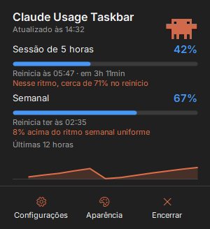
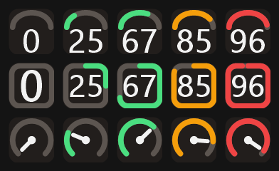
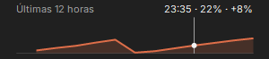
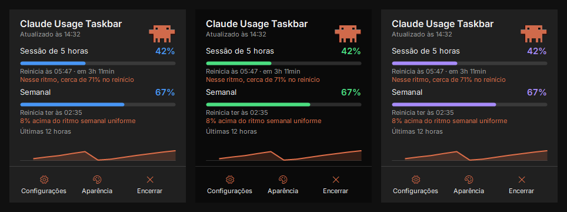
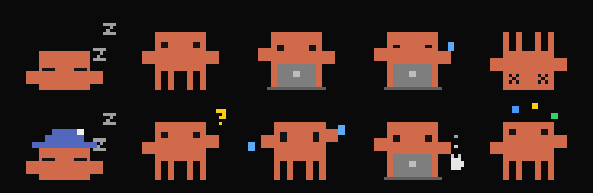
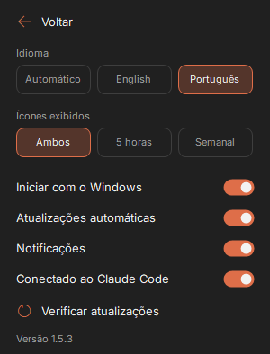
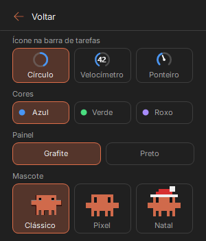

# Claude Usage Taskbar

[English](README.md) | **Português (Brasil)** | [Español](README.es.md) | [Русский](README.ru.md)

Veja os limites de uso do Claude Code na barra de tarefas do Windows, sem precisar abrir nada.



> Projeto não oficial da comunidade. Não tem vínculo, aprovação nem suporte da Anthropic. "Claude" é uma marca da Anthropic.

## Recursos

- Ícones na barra de tarefas com o uso de **5 horas** e o **semanal**. Mostre os dois, ou só um
- Três estilos de ícone: **Círculo**, **Velocímetro** e **Ponteiro**
- Três modelos de cor e dois temas de painel
- Painel com horários de reinício, previsão de ritmo e gráfico de 12 horas
- Mascote animado, com versões em pixels que reagem ao seu uso
- Alertas opcionais em 80% e 90% de um limite
- Inglês e português do Brasil, seguindo o idioma do Windows por padrão
- Inicia com o Windows, com atalhos na Área de Trabalho e no menu Iniciar
- Atualizações automáticas assinadas
- **Nunca lê seu login nem seu token do Claude**

## Instalação

### Antes de começar

Você precisa de:

- Windows 10 ou 11
- [Claude Code](https://code.claude.com/docs) instalado e conectado a um plano Pro, Max ou Ultra. Para fazer login, rode `claude` uma vez em um terminal

Não é preciso deixar um terminal aberto.

### Passo a passo

1. **Baixe** o `ClaudeUsageTaskbar.exe` na [versão mais recente](https://github.com/ggleoo/claude-usage-taskbar/releases/latest).
2. **Abra o arquivo baixado.** O Windows pode mostrar um aviso do SmartScreen, porque o app não tem um certificado pago de assinatura de código. Escolha **Mais informações** e depois **Executar assim mesmo**. Se preferir, antes [confira o arquivo](docs/SECURITY.pt-BR.md#confira-um-download) ou [compile você mesmo](#compilar-o-código).
3. **Escolha Sim** na janela de instalação. O app é instalado só para o seu usuário do Windows e faz a conexão com o Claude Code para você. Depois, você pode apagar o arquivo baixado.
4. **Deixe os ícones visíveis.** O Windows esconde ícones novos da bandeja. Arraste-os do menu **^** para a barra de tarefas, ou vá em **Configurações > Personalização > Barra de Tarefas > Outros ícones da bandeja do sistema** e ligue-os. São dois ícones, um para cada limite.
5. **Aguarde alguns segundos.** Os percentuais aparecem nos ícones, o que significa que está funcionando.

## Como usar

1. **Leia os ícones.** O limite de 5 horas tem número branco, e o semanal tem número colorido. A cor muda em 70% e fica vermelha em 90%.
2. **Passe o mouse** sobre um ícone para ver o percentual e o horário de reinício.
3. **Clique** em um ícone para abrir o painel. Clique fora dele ou aperte **Esc** para fechar.
4. **Escolha o estilo do ícone** em **Aparência**.
5. **Abra Configurações** no painel para o resto, e **Aparência** para cores e mascote.

**Encerrar** fecha só este app. Ele não sai da sua conta do Claude. Para reabrir, use o menu Iniciar ou a Área de Trabalho.

## O que você pode ver e mudar

### Estilos de ícone



Escolha em **Aparência**. De cima para baixo:

- **Velocímetro:** um mostrador com o número dentro.
- **Círculo:** enche em sentido horário a partir do topo. É o padrão.
- **Ponteiro:** um mostrador com ponteiro.

### Gráfico de uso



O gráfico mostra o uso de 5 horas nas últimas 12 horas. Passe o mouse sobre ele para ver o horário, o percentual naquele momento e quanto subiu desde a leitura anterior.

### Previsão de ritmo

- **Limite de 5 horas:** a previsão combina a média de toda a janela com a tendência recente, para que um pico isolado não domine o resultado. Ela aparece a partir de 5% de uso e 15 minutos de dados.
- **Limite semanal:** compara seu uso com um ritmo uniforme ao longo da semana. Mostra uma diferença, não uma previsão.

### Cores e temas



Em **Aparência**:

- **Cores:** azul por padrão, ou verde ou roxo. Valem para os ícones e as barras.
- **Painel:** grafite ou preto.

### Mascote



Por padrão, o painel mostra o mascote **Clássico** trabalhando no notebook. Escolha **Pixel** ou **Natal** e ele reage ao seu uso. Da esquerda para a direita:

| Estado | Quando |
|---|---|
| Dormindo | Sem uso há mais de 45 minutos, ou ainda sem dados |
| Descansando | O último uso foi entre 10 e 45 minutos atrás |
| Trabalhando no notebook | A porcentagem da sessão subiu nos últimos 10 minutos |
| Cansado e suando | Está trabalhando e um limite está em 90% ou mais |
| Caído | Um limite chegou a 100% |

Em **Aparência** você escolhe o visual:

- **Clássico:** a animação original, que não reage ao uso. É o padrão.
- **Pixel:** o mascote que reage ao uso, na linha de cima.
- **Natal:** o mesmo mascote com gorro de Papai Noel, na linha de baixo.

Este é um projeto de fã, sem vínculo ou aprovação da Anthropic, e o personagem pertence aos seus donos. A licença MIT não cobre o personagem.

### Configurações

<table>
<tr>
<td></td>
<td></td>
</tr>
</table>

| Opção | O que faz |
|---|---|
| Idioma | Automático, inglês ou português |
| Ícones exibidos | Os dois limites, só 5 horas ou só semanal |
| Iniciar com o Windows | Abre o app quando você entra no Windows |
| Atualizações automáticas | Instala sozinho as atualizações assinadas |
| Notificações | Alertas em 80% e 90% de um limite, e aviso quando uma atualização é instalada |
| Conectado ao Claude Code | Liga ou desliga a conexão |
| Verificar atualizações | Procura uma atualização agora. O ícone gira enquanto verifica e vira um símbolo de baixar quando há uma pronta |

## Como a conexão funciona

O app lê seus limites de duas formas oficiais:

- **Comando `/usage`:** a cada 2 minutos ele roda `claude -p /usage` em segundo plano, com os mesmos números que você vê no Claude Code. Isso não chama o modelo nem gasta tokens.
- **[Status line](https://code.claude.com/docs/en/statusline):** na instalação, ele adiciona uma entrada `statusLine` em `~/.claude/settings.json` e salva um backup ao lado. O Claude Code então envia números novos a cada resposta em um terminal.

Nos dois casos, o app guarda só os percentuais e os horários de reinício dos limites de 5 horas e semanal em `%LOCALAPPDATA%\ClaudeUsageTaskbar`, e descarta o resto. O widget lê esse arquivo.

Bom saber:

- **O uso de qualquer lugar conta.** claude.ai, app desktop e terminais aparecem em até 2 minutos.
- **Uma status line que você já tenha é mantida.** Ela continua rodando e mostrando o mesmo de antes. Ao desinstalar, ela é restaurada.
- **Para desconectar,** desligue **Conectado ao Claude Code** em Configurações.

## Segurança e privacidade

- O app não lê seu login, seu token nem seu arquivo de credenciais.
- Ele não guarda seus prompts, dados de sessão nem caminhos de projetos.
- Ele não tem analytics, telemetria nem conta.
- O acesso à rede do próprio app é só a verificação de atualizações assinadas no GitHub, que você pode desligar. O comando `/usage` é do Claude Code, que usa seu login sem mostrá-lo ao app.

Os detalhes estão em [docs/SECURITY.pt-BR.md](docs/SECURITY.pt-BR.md).

## Atualizações

Ao abrir e depois a cada hora, o app verifica a versão mais recente no GitHub. Ele só instala uma atualização se a assinatura digital bater com a chave embutida no app, então um arquivo adulterado é rejeitado. Você pode desligar isso em Configurações, onde **Verificar atualizações** também faz uma verificação na hora. A verificação ao abrir instala a atualização na hora, sem perguntar. As verificações seguintes esperam o painel fechar e, enquanto isso, mostram um link para instalar. Uma notificação confirma a atualização, a menos que você desligue **Notificações**.

## Desinstalação

Vá em **Configurações do Windows > Aplicativos > Aplicativos instalados > Claude Usage Taskbar > Desinstalar**. Isso remove o app, os atalhos e as configurações, e restaura sua status line do Claude Code.

## Solução de problemas

| Problema | O que fazer |
|---|---|
| "Aguardando o Claude Code" | Aguarde alguns segundos. Se continuar, rode `claude` em um terminal para confirmar que o Claude Code está instalado e com login feito. |
| Os percentuais continuam sem aparecer | Confira se **Conectado ao Claude Code** está ligado e rode `claude -p /usage` em um terminal. Os dados existem nos planos Pro, Max e Ultra. |
| Os ícones estão escondidos | Siga o passo 4 do [passo a passo](#passo-a-passo). |
| Não foi possível ligar a conexão | O `~/.claude/settings.json` pode ter um JSON inválido. Corrija e tente de novo. |
| Um percentual parece antigo | É o último valor que foi possível ler. O app tenta de novo a cada 2 minutos. |

## Compilar o código

Não é preciso instalar SDK, porque o Windows já inclui o compilador C#.

```powershell
git clone https://github.com/ggleoo/claude-usage-taskbar.git
cd claude-usage-taskbar
pwsh -File scripts/build.ps1
```

O app é gerado em `bin\ClaudeUsageTaskbar.exe`. Use `--portable` para rodar sem instalar.

Quem quiser contribuir deve ler o [CONTRIBUTING.md](CONTRIBUTING.md).

## Créditos

O painel usa a fonte [Inter](https://github.com/rsms/inter), sob a licença SIL Open Font License. Veja [assets/fonts/NOTICE.md](assets/fonts/NOTICE.md).

## Licença

[MIT](LICENSE)
