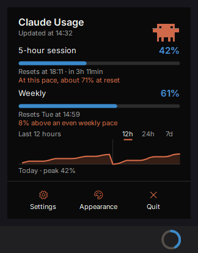
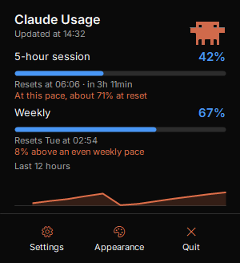
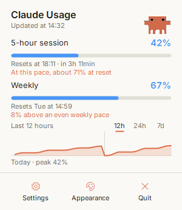
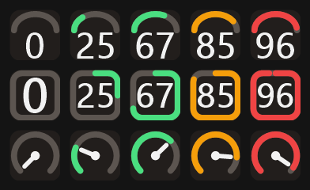
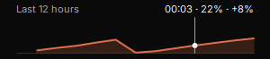
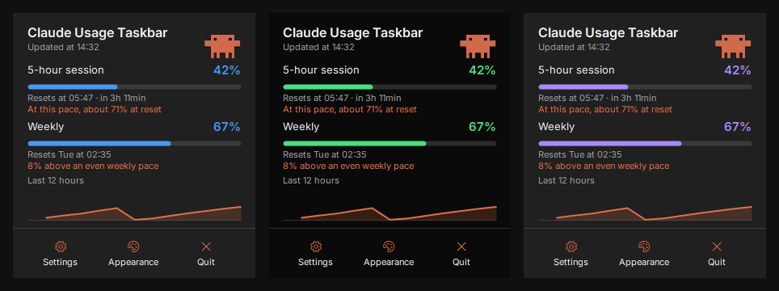
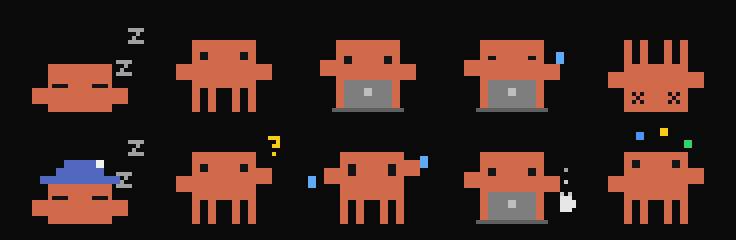
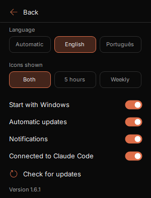
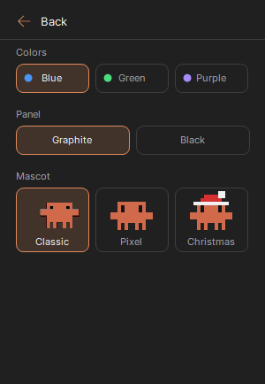

# Claude Usage Taskbar

[English](README.md) | [Português (Brasil)](README.pt-BR.md) | [Español](README.es.md) | **Русский**

Лимиты Claude Code всегда на виду на панели задач Windows, а прогноз покажет, когда они закончатся и хватит ли их до сброса.

[](https://github.com/leotrvs/claude-usage-taskbar/releases/latest/download/ClaudeUsageTaskbar.exe)



> Приложение доступно на английском и португальском языках. Снимки экрана на этой странице на английском.

<p>



</p>

> Неофициальный проект сообщества. Он не связан с Anthropic и не одобрен и не поддерживается этой компанией. Claude является товарным знаком Anthropic.

## Возможности

- Значки на панели задач с использованием за **5 часов** и за **неделю**. Можно показывать оба или один
- Три стиля значков: **Ring**, **Gauge** и **Needle**
- Три цветовых шаблона и четыре темы, включая тему, которая следует за Windows
- Окно со временем сброса, прогнозом темпа и графиком за 12 часов
- Анимированный маскот и пиксельные версии, которые реагируют на использование
- Необязательные оповещения при 80% и 90% лимита и уведомление об обновлении лимита
- Меню по правому клику на значках: Open panel, Refresh now, Settings и Quit
- Запуск вместе с Windows, ярлыки на рабочем столе и в меню «Пуск»
- Подписанные автоматические обновления
- **Никогда не читает ваш логин или токен Claude**

## Установка

### Перед началом

Вам понадобятся:

- Windows 10 или 11
- Установленный [Claude Code](https://code.claude.com/docs) со входом в план Pro, Max или Ultra. Чтобы войти, один раз выполните `claude` в терминале

Держать терминал открытым не нужно.

### Пошаговая инструкция

1. **Скачайте** `ClaudeUsageTaskbar.exe` со страницы [последнего выпуска](https://github.com/leotrvs/claude-usage-taskbar/releases/latest).
2. **Откройте скачанный файл.** Windows может показать предупреждение SmartScreen, потому что у приложения нет платного сертификата подписи кода. Нажмите **Подробнее**, затем **Выполнить в любом случае**. При желании сначала [проверьте файл](SECURITY.md#verify-a-download) или [соберите приложение сами](#сборка-из-исходного-кода).
3. **Нажмите Yes** в окне установки. Приложение устанавливается только для вашего пользователя Windows и само подключается к Claude Code. После этого скачанный файл можно удалить.
4. **Оставьте значки на виду.** Windows скрывает новые значки в трее. Перетащите их из меню **^** на панель задач или откройте **Параметры > Персонализация > Панель задач > Другие значки на панели задач** и включите их. Значков два, по одному на каждый лимит.
5. **Подождите несколько секунд.** На значках появятся проценты. Это значит, что всё работает.

## Использование

1. **Смотрите на значки.** У лимита на 5 часов белое число, у недельного цветное. Цвет меняется при 70% и становится красным при 90%.
2. **Наведите указатель** на значок, чтобы увидеть процент и время сброса.
3. **Нажмите** на значок, чтобы открыть окно. Чтобы закрыть его, нажмите вне окна или клавишу **Esc**. **Правый клик** по значку открывает меню с пунктами **Open panel**, **Refresh now**, **Settings** и **Quit**.
4. **Выберите стиль значка** в разделе **Appearance**.
5. **Откройте Settings** в окне для остальных настроек и **Appearance** для цветов и маскота.

**Quit** закрывает только это приложение и не выполняет выход из Claude. Снова открыть его можно из меню «Пуск» или с рабочего стола.

## Что можно посмотреть и изменить

### Стили значков



Выберите его в разделе **Appearance**. Сверху вниз:

- **Gauge:** шкала с числом внутри.
- **Ring:** круг, который заполняется по часовой стрелке сверху. Этот стиль используется по умолчанию.
- **Needle:** шкала со стрелкой.

### График использования



График показывает использование 5-часового лимита за последние 12 часов. Наведите на него указатель, чтобы увидеть время, процент в этот момент и рост с предыдущего замера.

### Прогноз темпа

- **Лимит на 5 часов:** прогноз сочетает среднее значение за всё окно с недавней тенденцией. Вдали от лимита один всплеск не определяет результат, а рядом с ним важнее всего последние минуты. Он появляется после 5% использования и 15 минут данных.
- **Недельный лимит:** ваше использование сравнивается с равномерным темпом в течение недели. Показывается разница, а не прогноз.

### Цвета и темы



В разделе **Appearance**:

- **Colors:** по умолчанию синий, также зелёный или фиолетовый. Цвет применяется к значкам и полосам.
- **Theme:** по умолчанию Auto, также графитовая, чёрная или светлая. Auto следует за режимом Windows: светлая в светлом режиме и чёрная в тёмном.

### Маскот

По умолчанию в окне показан маскот **Classic**, работающий за ноутбуком:


Маскот реагирует на использование. Classic показывает эту анимацию во время работы, а в остальных состояниях пиксельные рисунки. Слева направо:



| Состояние | Когда |
|---|---|
| Спит | Нет открытых сессий и недавнего использования или ещё нет данных |
| Отдыхает | Сессия открыта, но простаивает, или последнее использование было менее 45 минут назад |
| Работает за ноутбуком | Сессия Claude Code работает или процент вырос за последние 10 минут |
| Устал и потеет | Он работает, а один из лимитов достиг 90% или больше |
| Упал | Один из лимитов достиг 100% |
| Спит в колпаке | То же, что сон, но глубокой ночью |
| Спрашивает со знаком вопроса | Сессии нужно ваше разрешение или ответ |
| Паникует | По прогнозу лимит закончится менее чем через 30 минут |
| Пьёт кофе | Работает более 2 часов |
| Жонглирует | Одновременно работают три сессии или больше |

Он также радуется обновлению лимита, машет при наведении указателя и реагирует на клик.

В разделе **Appearance** можно выбрать внешний вид:

- **Classic:** исходная анимация во время работы и пиксельные рисунки в остальных состояниях. Используется по умолчанию.
- **Pixel:** пиксельные рисунки всё время.
- **Christmas**, **Headphones** и **Chef:** тот же маскот в образе. Chef говорит `im cooking` во время работы.


Это фан-проект, не связанный с Anthropic и не одобренный ею. Персонаж принадлежит его владельцам, и лицензия MIT на него не распространяется.

### Настройки

<table>
<tr>
<td></td>
<td></td>
</tr>
</table>

| Параметр | Что делает |
|---|---|
| Language | Автоматически, английский или португальский |
| Icons shown | Оба лимита, только 5 часов или только неделя |
| Start with Windows | Открывает приложение при входе в Windows |
| Automatic updates | Сам устанавливает подписанные обновления |
| Notifications | Оповещения при 80% и 90% лимита и уведомления об обновлении лимита и установке обновления |
| Connected to Claude Code | Включает или отключает подключение |
| Check for updates | Проверяет обновления сейчас. Значок вращается во время проверки и становится значком загрузки, когда обновление готово |

## Как работает подключение

Приложение читает лимиты двумя официальными способами:

- **Команда `/usage`:** каждые 2 минуты и при открытии окна оно выполняет `claude -p /usage` в фоновом режиме и получает те же числа, что и в Claude Code. Модель не вызывается, токены не расходуются.
- **[Status line](https://code.claude.com/docs/en/statusline):** при установке оно добавляет запись `statusLine` в `~/.claude/settings.json` и сохраняет рядом резервную копию. После этого Claude Code передаёт свежие числа после каждого ответа в терминале.

В обоих случаях приложение сохраняет только проценты и время сброса лимитов на 5 часов и неделю в `%LOCALAPPDATA%\ClaudeUsageTaskbar`, а остальное отбрасывает. Виджет читает этот файл.

Полезно знать:

- **Учитывается использование отовсюду.** claude.ai, настольное приложение и терминалы отражаются в течение 2 минут.
- **Существующая status line сохраняется.** Она продолжает работать и показывать то же, что и раньше. При удалении приложения она восстанавливается.
- **Чтобы отключить подключение,** выключите **Connected to Claude Code** в Settings.

## Безопасность и конфиденциальность

- Приложение не читает ваш логин, токен или файл учётных данных.
- Оно не хранит ваши запросы, данные сессий и пути к проектам.
- В нём нет аналитики, телеметрии и учётных записей.
- Само приложение обращается к сети только для проверки подписанных обновлений на GitHub, и это можно отключить. Команда `/usage` принадлежит Claude Code, который использует ваш вход, не показывая его приложению.

Подробности в [SECURITY.md](SECURITY.md) на английском языке.

## Обновления

При запуске и затем каждый час приложение проверяет последний выпуск на GitHub. Обновление устанавливается, только если его цифровая подпись совпадает с ключом, встроенным в приложение, поэтому изменённый файл будет отклонён. Это можно отключить в Settings, где **Check for updates** также запускает проверку вручную. Проверка при запуске сразу устанавливает обновление, ничего не спрашивая. Последующие проверки ждут закрытия окна, а пока показывают ссылку для установки. Уведомление подтвердит обновление, если вы не отключили **Notifications**.

## Удаление

Откройте **Параметры Windows > Приложения > Установленные приложения > Claude Usage Taskbar > Удалить**. Будут удалены приложение, ярлыки и настройки, а status line Claude Code будет восстановлена.

## Устранение неполадок

| Проблема | Что делать |
|---|---|
| "Waiting for Claude Code" | Подождите несколько секунд. Если сообщение не исчезает, выполните `claude` в терминале и проверьте, что Claude Code установлен и вход выполнен. |
| "Claude Code not found" | Установите [Claude Code](https://code.claude.com/docs) и выполните `claude` в терминале, чтобы войти. |
| Проценты всё ещё не появляются | Проверьте, что **Connected to Claude Code** включено, и выполните `claude -p /usage` в терминале. Данные доступны на планах Pro, Max и Ultra. |
| Значки скрыты | Выполните шаг 4 из [пошаговой инструкции](#пошаговая-инструкция). |
| Не удалось включить подключение | Возможно, в `~/.claude/settings.json` недопустимый JSON. Исправьте его и повторите попытку. |
| Жёлтая надпись "out of date" | Последние чтения не удались, поэтому числа могут быть устаревшими. Приложение повторяет попытку каждые 2 минуты. |

## Сборка из исходного кода

SDK не нужен, потому что компилятор C# входит в состав Windows.

```powershell
git clone https://github.com/leotrvs/claude-usage-taskbar.git
cd claude-usage-taskbar
pwsh -File scripts/build.ps1
```

Приложение создаётся в `bin\ClaudeUsageTaskbar.exe`. Используйте `--portable`, чтобы запустить его без установки.

Если хотите участвовать в разработке, прочитайте [CONTRIBUTING.md](CONTRIBUTING.md).

## Благодарности

В окне используется шрифт [Inter](https://github.com/rsms/inter) по лицензии SIL Open Font License. См. [assets/fonts/NOTICE.md](assets/fonts/NOTICE.md).

## Лицензия

[MIT](LICENSE)
